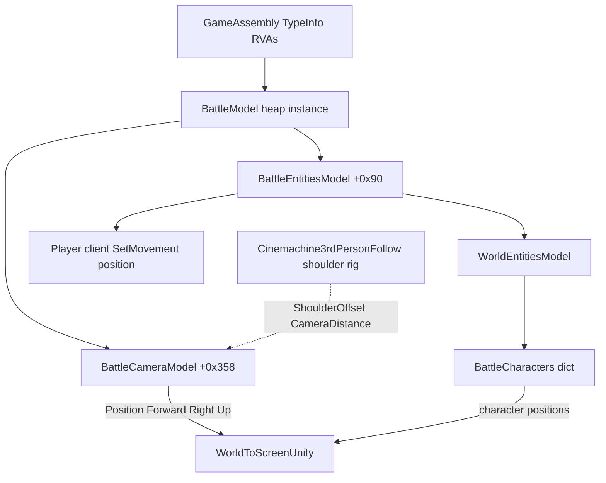

# Rob Run Driver2 ESP — IDA / IL2CPP map

Dump: `dumps/2026-11-13` (GameAssembly `SizeOfImage` **0x8D01800** live band **0x8FDC000**).

Open in IDA: `GameAssembly.dll` (or sync names via `dma/ida-offset-mcp` + `offset_apply_dump_names`).

## Data flow (3rd person shoulder)



**Why shoulder matters:** the lens is not at the character root. `BattleCameraModel` carries the **corrected eye** (forward/right/up from the updater). Fallback in the external uses client yaw/pitch + default `Cinemachine3rdPersonFollow` distances (`offsets::third_person::*` in `dma/src/engine/offsets.h`).

## Chain (field offsets — PE-confirmed)

| Step | C# accessor | Instance field | Notes |
|------|-------------|----------------|-------|
| Game | `Game.get_GameModel` | `GameModel` **+0xD0** | Not a singleton; find via heap/GOM in DMA |
| GameModel | `IDevelopGameModel.get_BattleModel` | `BattleModel` **+0x10** | |
| BattleModel | `get_BattleEntitiesModel` | **+0x90** | RVA below |
| BattleModel | `get_BattleCameraModel` | **+0x358** | Shoulder-aligned camera |
| BattleEntities | `get_Player` | **+0xD0** | Local entity |
| WorldEntities | `BattleCharacters` | world **+0x18** | ESP targets |
| PlayerClient | `SetMovement` | **+0x30** | Client view position |
| PlayerClient | `Rotation` | **+0x38** | Yaw/pitch for rig fallback |

## Getter RVAs (script.json 2026-11-13)

| Method | RVA |
|--------|-----|
| `Game.Battle.BattleModel$$get_BattleEntitiesModel` | **0x7A9F90** (`[rcx+0x90]`) |
| `Game.Battle.BattleModel$$get_BattleCameraModel` | **0x929CA0** (`[rcx+0x358]`) |
| `Game.Game$$get_GameModel` | **0x904DA0** (`[rcx+0xD0]`) |
| `Game.GameModel$$Game.IDevelopGameModel.get_BattleModel` | **0x7EB6B0** (`[rcx+0x10]`) |
| `Start.UnityEntry$$get_Game` | **0x7A9000** (`[rcx+0x28]`) |
| `Cinemachine.CinemachineBrain$$get_OutputCamera` | **0xDC4B00** |

## TypeInfo symbols (image RVA)

From `OFFSET_REPORT.md` / `offsets::typeinfo`:

| Type | RVA |
|------|-----|
| `Game.Game` | 0x81455F8 |
| `Game.GameModel` | 0x81465C0 |
| `Game.Battle.BattleModel` | 0x81D8010 |
| `Game.Battle.BattleEntitiesModel` | 0x81D46B0 |
| `Game.Battle...BattleCameraModel` | 0x81CB420 |
| `Cinemachine.CinemachineBrain` | 0x8162410 |
| `Cinemachine.Cinemachine3rdPersonFollow` | 0x8161F40 |

## IDA MCP workflow (`user-ida-pro-mcp`)

1. `idb_open` with path to your `GameAssembly.dll` (build must match Steam).
2. `offset_status` — image base + dump path.
3. Per getter: `offset_disasm` at RVA → expect `mov rax,[rcx+disp]; ret`.
4. `offset_confirm_getter` — records **field offset** for the disasm you’re standing on.
5. Shoulder rig fields: `offset_field_from_dump` on `Cinemachine3rdPersonFollow` (`ShoulderOffset` 0x34, `CameraDistance` 0x48, live distance 0xD0).
6. `offset_xrefs_to` on `BattleCameraModelUpdater` ctor — who feeds the packed camera block.

### BattleCameraModel layout (IDA / dump.cs)

Packed read used by DMA external (`offsets::battle_camera`):

- `Position` +0x10 `Vector3`
- `Orientation` +0x1C quaternion
- `Forward` +0x3C, `Right` +0x48, `Up` +0x54
- Use **Forward/Right/Up** for W2S (includes shoulder roll); yaw-only math drifts boxes.

### Cinemachine brain (optional refinement)

`CinemachineBrain.CurrentCameraState` @ **+0xB0** — `RawPosition` +0xFC, corrections +0x128 / +0x134. DMA prefers **CorrectedPosition** = raw + correction (see `offsets::cinemachine_brain`).

## Build & run (Driver2)

```powershell
cd byovd\driver2
.\build.ps1 -BuildRobRunEsp
# After ranked-safe map on game PC:
.\bin\robrun_esp_external.exe --overlay
```

Binary: `byovd/driver2/bin/robrun_esp_external.exe` (also copied to `byovd/bin` when build script mirrors examples).
